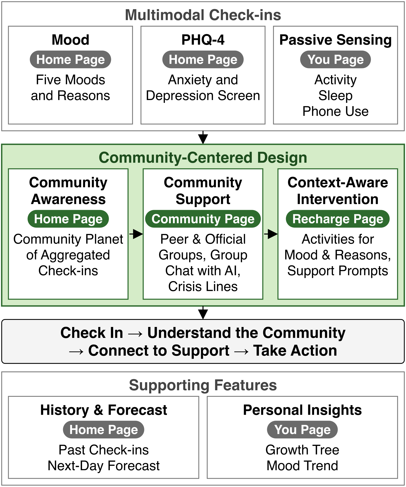

# MoodSense

A mobile mental health app for community awareness, support, and
intervention. Users check in on their mood, see how their community is
doing, join support groups, and get small activities matched to how they
feel.
 



## Demo video

https://github.com/user-attachments/assets/fb9c23b7-c7a2-4545-9504-d58c42fc8cd6

If the player above does not load, download or open the video directly: [media/demo.mp4](media/demo.mp4)

## Try the app

- **Android:** download the APK from
  [Releases](https://github.com/tump-lab/moodesense_v1/releases/tag/android-v1.0.0-8) and install it.
- **iOS:** public TestFlight beta is pending App Review; the link will be added once approved.
  Internal TestFlight testing is available by invitation on request.

Sign up with email and password.

## Code

Expo / React Native / TypeScript app with optional Firebase sync.

```bash
npm install
npm run android   # or: npm run ios
```

## License

See [LICENSE](LICENSE).
