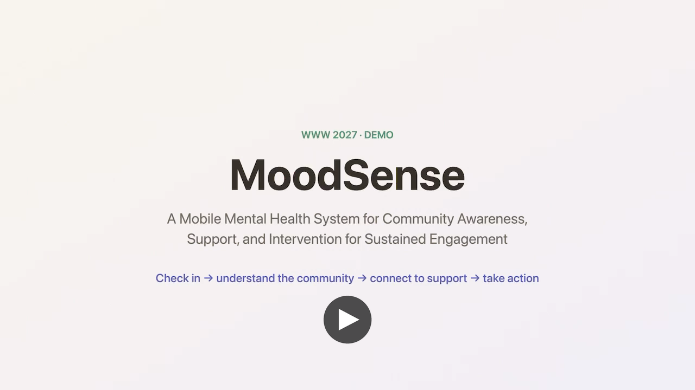

# MoodSense

A mobile mental health app for community awareness, support, and
intervention. Users check in on their mood, see how their community is
doing, join support groups, and get small activities matched to how they
feel.
 

<p align="center">
  
</p>

## Demo video

<p align="center">
  <a href="media/demo.mp4"></a>
</p>

## Try the app

- **Android (arm64, Android 8+):** download
  [`MoodSense-android.apk`](https://anonymous.4open.science/api/repo/moodsense-demo-7K3Q/file/apk/MoodSense-android.apk) and install it; allow installs from unknown sources if asked.
- **iOS:** install [TestFlight](https://apps.apple.com/app/testflight/id899247664)
  from the App Store, then open the public TestFlight link
  [testflight.apple.com/join/NVpfj4MK](https://testflight.apple.com/join/NVpfj4MK)
  on iPhone.

Sign up with email and password.

## Code

Expo / React Native / TypeScript app with optional Firebase sync.

```bash
npm install
npm run android   # or: npm run ios
```

## License

See [LICENSE](LICENSE).
